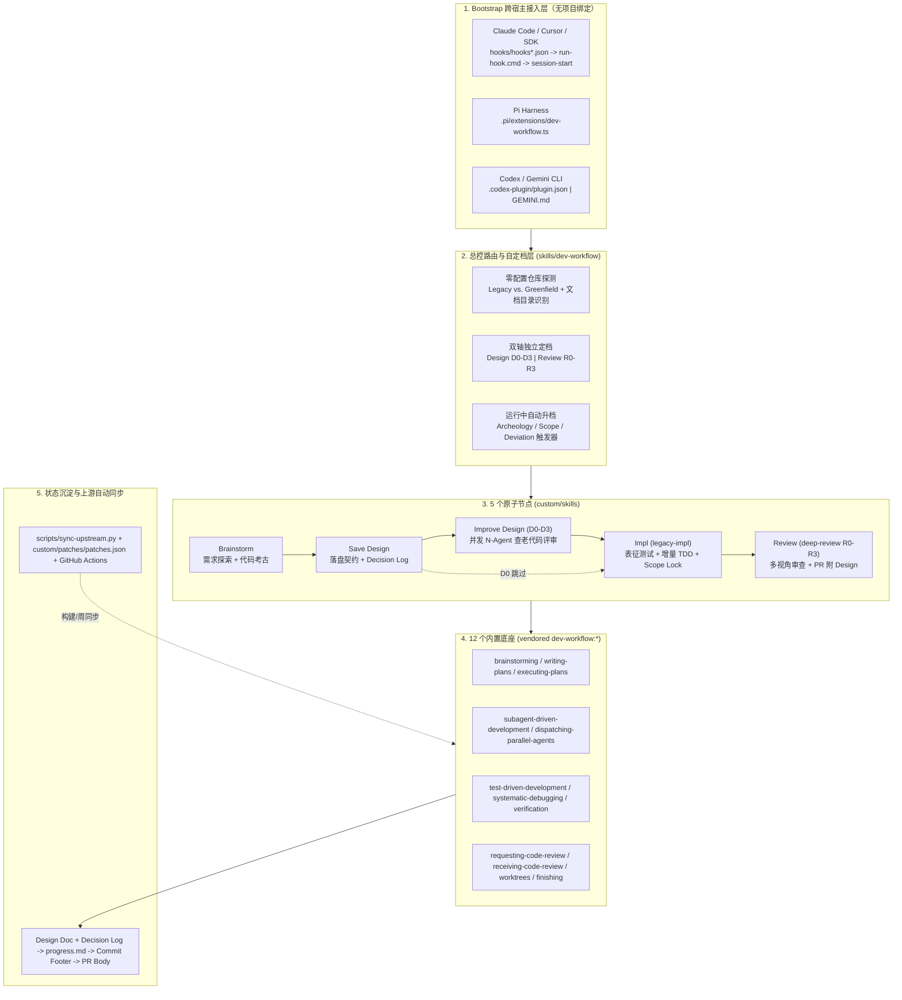
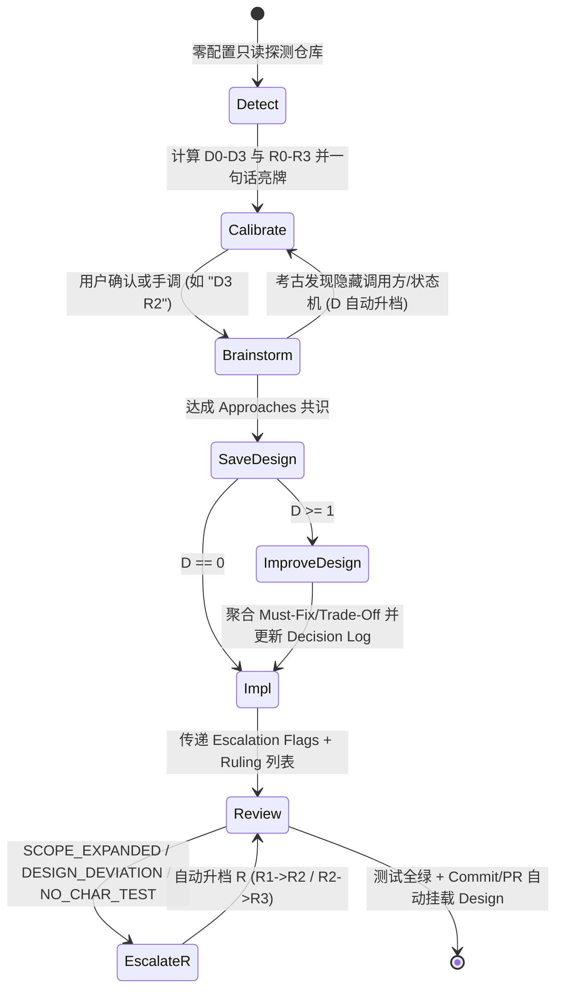

# dev-workflow 架构说明

本文档说明 `dev-workflow` 独立单插件的整体分层架构、5 个原子节点与 `D/R` 双轴自定档机制、历史项目护栏、状态追溯主线，以及上游 `obra/superpowers` 自动同步流水线。

## 1. 整体分层架构

## 2. 双轴独立定档与自动升档机制

`Improve Design` 与 `Review` 被设计为**同等重要、彼此独立的一等深度旋钮**，不采用二选一的刚性模式：

| 维度 | 判定信号（满足项越多，档位越高） | 档位行为 |
| :--- | :--- | :--- |
| **轴 A：设计不确定性 → `Improve Design` (`D0–D3`)** | 需求含糊 / 跨模块或数据契约变更 / 存量高耦合需找接缝 / 设计失误返工成本高 | `D0` 跳过；`D1` 2 并发（自由 + 回归）；`D2` 3 并发（+ 最小侵入）；`D3` 5 并发（+ 可测试性 + YAGNI，支持第 2 轮收敛） |
| **轴 B：实现与回归爆炸半径 → `Review` (`R0–R3`)** | 触碰核心链路、并发、权限或持久化 / 老代码缺单测 / 多文件原地修改 / 前置设计偏简略 | `R0` 测试自检；`R1` 1 次全分支只读终审；`R2` 关键点 + 全分支终审；`R3` 逐任务双审 + 3 视角并发全分支终审 |

### 动态流转与自动升档（Escalation）

## 3. 历史项目（Legacy Mode）五项护栏

当总控探测到目标仓库已有提交历史与业务代码时，自动启用 Legacy Mode：

1. **前置代码考古**：Brainstorm 阶段先查调用链（callers/callees）、隐式入口（MQ/Cron/配置）与近期 `git log`，再提出方案。
2. **变更边界契约**：`save-design` 强制记录现状与隔离接缝（Seam）、影响面、兼容与脏数据处理、回滚方案以及明确不动的历史债（Non-Goals）。
3. **基于真实代码的并发评审**：`improving-design` 派发的 `N` 个独立子代理拥有只读代码库权限，必须用 `grep`/读文件证伪设计假设，防止脱离现状的空谈建议。
4. **表征测试 + 增量 TDD + Strict Scope Lock**：修改存量逻辑前先补表征测试锁住现网行为；新逻辑走严格 RED→GREEN TDD；严禁顺手重构或格式化无关老代码。
5. **全链路设计可追溯**：`Design Doc` 独立提交 → 实现 Commit Footer 附 `Design: <path>` → PR 自动注入 `## Design & Key Decisions`。

## 4. 目录职责边界（源码层 vs. 构建产物层）

| 路径 | 角色 | 说明 |
| :--- | :--- | :--- |
| `custom/skills/` | **定制源码（Source of Truth）** | 5 个自有原子技能（`dev-workflow`、`save-design`、`improving-design`、`legacy-impl`、`deep-review`），永不被上游同步覆盖 |
| `custom/patches/patches.json` | **声明式上游补丁** | 对上游 3 个文件的最小锚点补丁（`brainstorming`、`implementer-prompt.md`、`finishing-a-development-branch`），锚点失效时显式报错 |
| `vendor-manifest.json` & `upstream.lock` | **上游清单与版本锁** | 声明抽取的 12 个 `obra/superpowers` 技能、命名空间重写规则（`superpowers:` → `dev-workflow:`）及已同步 commit SHA |
| `skills/` | **最终运行时技能目录** | 由 `scripts/sync-upstream.py` 合并上游 12 个技能 + 定制 5 个技能 + 补丁后的完整产物，零外部依赖 |
| `hooks/` & `.pi/` & `.*-plugin/` | **多平台接入层** | 适配 Pi、Codex (App/CLI)、Cursor、Claude Code、Gemini CLI 与 Copilot SDK |
| `tests/` | **自动化防回归防线** | `test_plugin.py`（跨平台全量自检）+ `tests/pi/test-pi-extension.mjs`（Pi 扩展生命周期单测） |

## 5. 上游自动同步流水线

1. **定时巡检**：`.github/workflows/sync-upstream.yml` 每周一对比 `obra/superpowers` 的 `main` HEAD 与 `upstream.lock`。
2. **自动构建**：检测到新提交后执行 `python3 scripts/sync-upstream.py`：拉取上游 → 抽取 12 个技能与 MIT `LICENSE` → 批量重写 `superpowers:` 为 `dev-workflow:` → 叠加 `custom/skills/` → 施加 `custom/patches/patches.json` → 运行 `tests/test_plugin.py`。
3. **自动交付或告警**：测试全绿自动开 PR；若上游改动导致补丁锚点失效，自动开带错误日志的 Issue 提醒人工微调对应补丁。
